
<ul style="list-style:none">
<h2>Theme repository for FCP</h2>
</ul>

> [!IMPORTANT]
> Before submitting a theme please read [CONTRIBUTING.md](CONTRIBUTING.md).
>
> Make sure your theme is compatible with the latest version of File Converter Pro.
>
> Please submit clean and well formatted themes. A workflow checks every pull request automatically, and a theme that fails the checks won't be merged.
>
> For the theme screenshot, take a picture of the whole app window with your theme applied.

# FCP Themes

Custom themes for [File Converter Pro](https://file-converter-pro.org).

## Install a theme

Download a `.fctheme` file below, then in File Converter Pro go to **Settings**, **Themes**, click **Install a theme (.fctheme)** and pick the file. Click **Apply**, then **OK**.

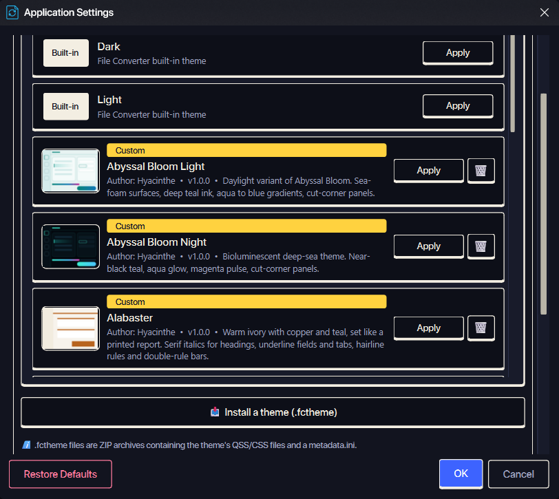

## Submitting a Theme

1. Fork this repository.
2. Copy `themes/theme_template` to `themes/<Theme_Name>` and make it yours. The details are in [CONTRIBUTING.md](CONTRIBUTING.md).
3. Open a pull request with the title `[create-theme]: <theme-name>`.
4. Let us take care of the rest!

## Updating a Theme

1. Open a pull request with the updated theme.
2. Include the theme name in the title, like `[update-theme]: <theme-name>`.
3. Let us take care of the rest!

> This applies to any other action you want to take with the themes in this repository, such as deleting a theme.

## Themes

<!-- themes:start -->
### [Abyssal_Bloom_Light.fctheme](themes/Abyssal_Bloom_Light.fctheme)

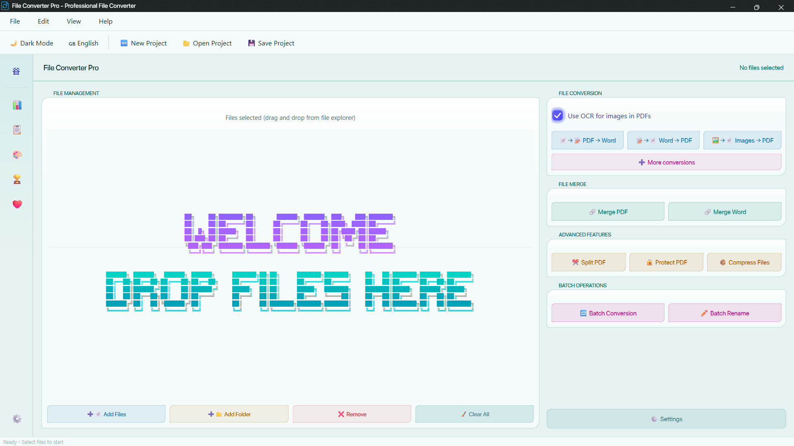

### [Abyssal_Bloom_Night.fctheme](themes/Abyssal_Bloom_Night.fctheme)

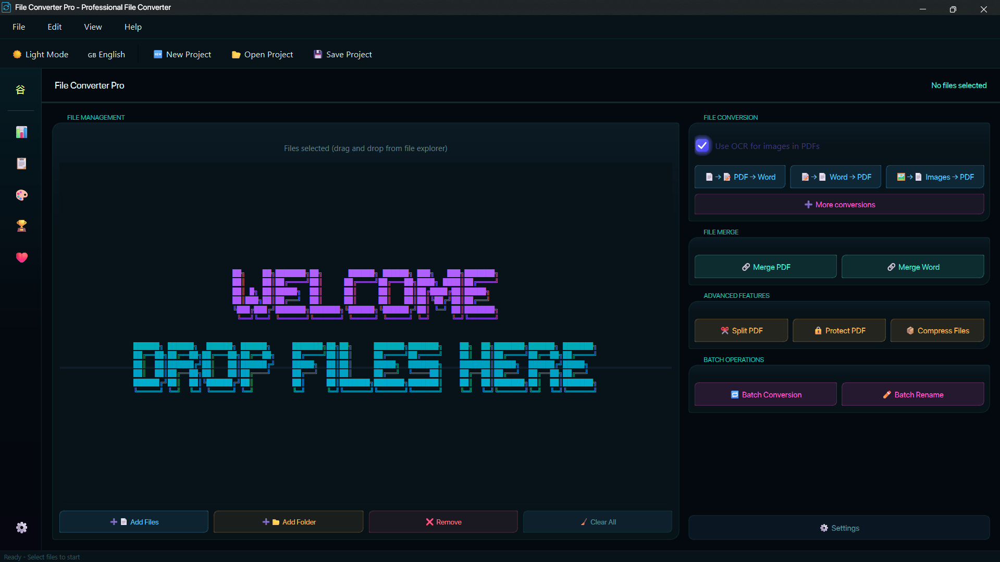

### [Alabaster.fctheme](themes/Alabaster.fctheme)

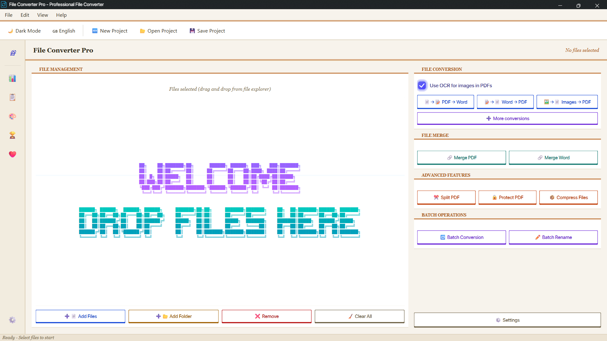

### [Catppuccin_Mocha.fctheme](themes/Catppuccin_Mocha.fctheme)

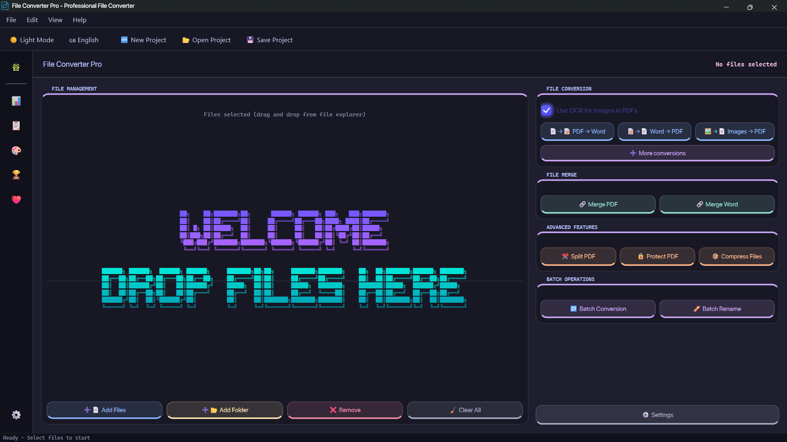

### [Everforest.fctheme](themes/Everforest.fctheme)

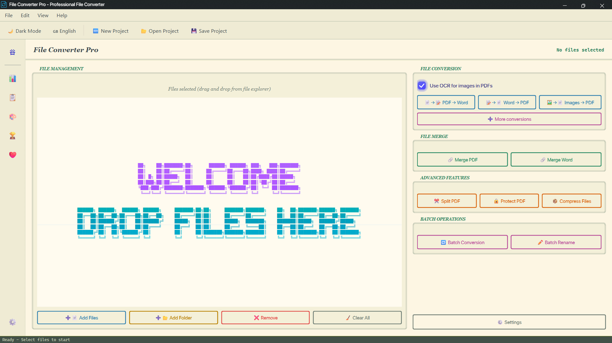

### [Kintsugi.fctheme](themes/Kintsugi.fctheme)

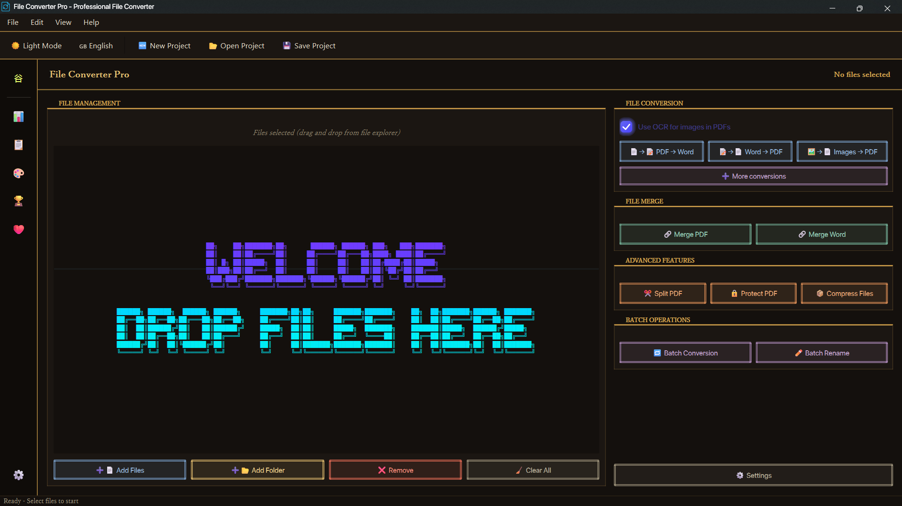

### [Obsidian.fctheme](themes/Obsidian.fctheme)

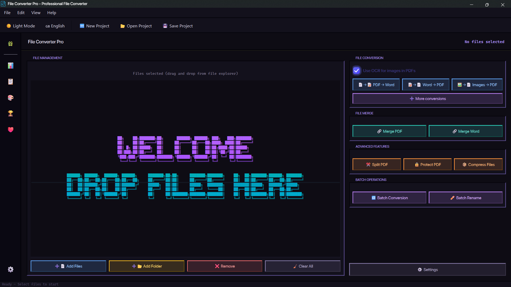

### [Onyx.fctheme](themes/Onyx.fctheme)

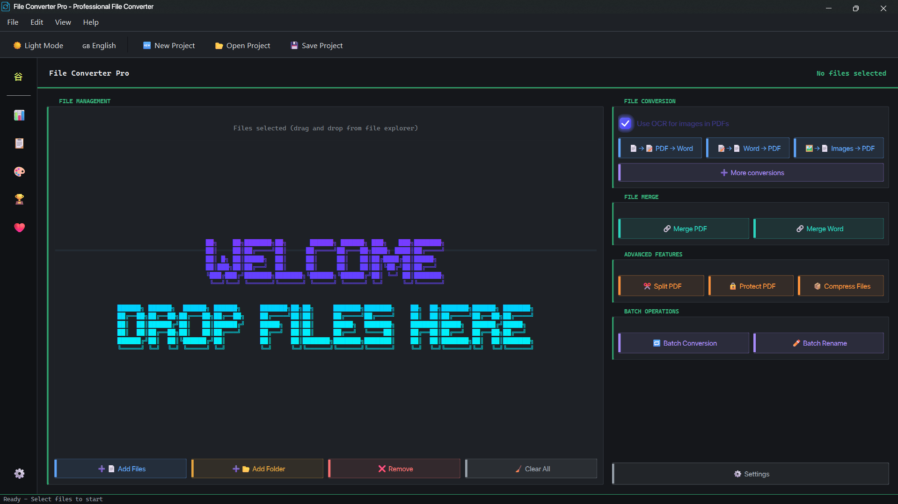

### [Opaline.fctheme](themes/Opaline.fctheme)

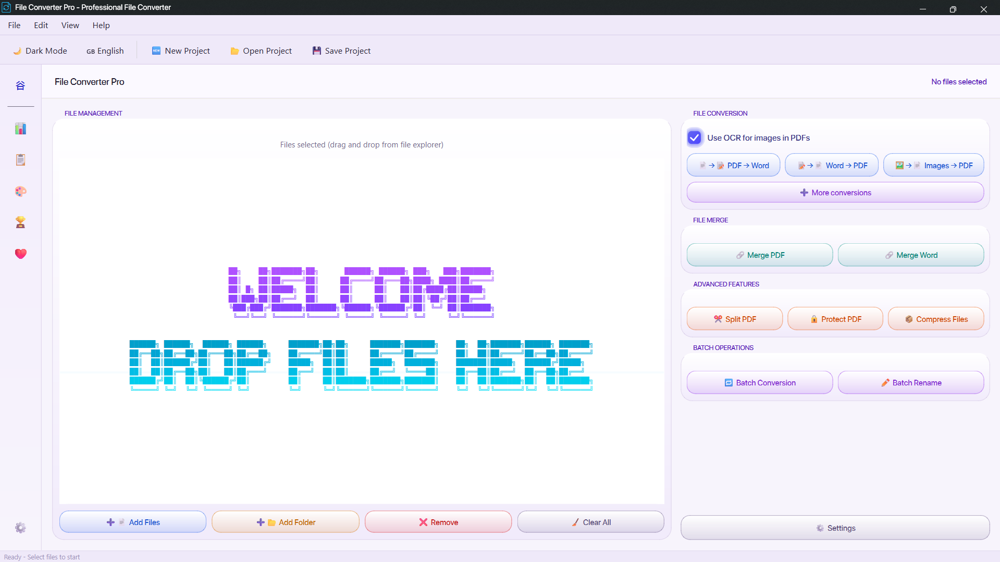

### [Riso_Press_Light.fctheme](themes/Riso_Press_Light.fctheme)

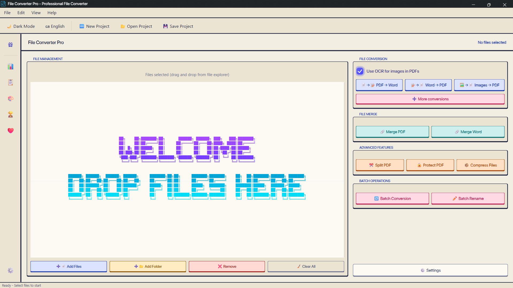

### [Riso_Press_Night.fctheme](themes/Riso_Press_Night.fctheme)

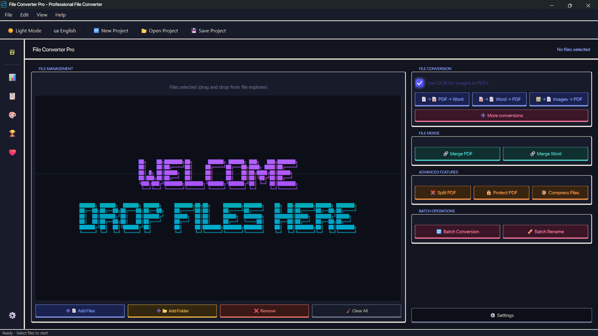

### [Shoji.fctheme](themes/Shoji.fctheme)

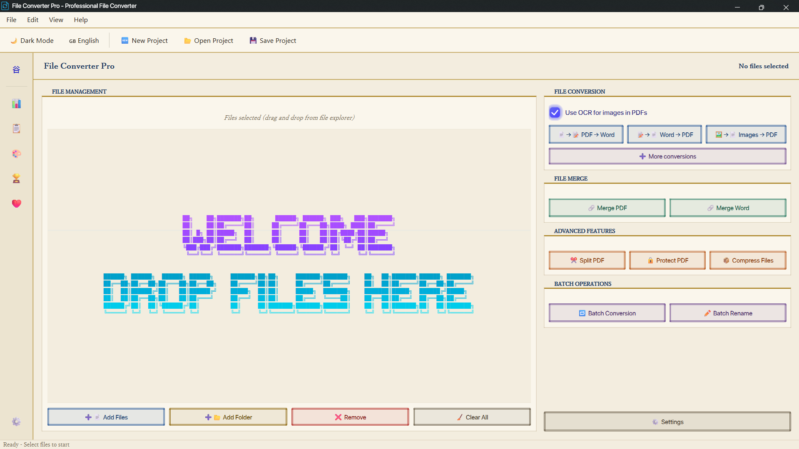
<!-- themes:end -->

## License

[MIT](LICENSE)
